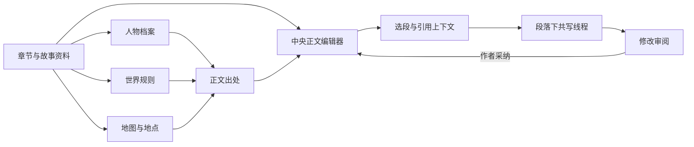

# 小说创作客户端：项目框架

更新：2026-10-12。当前只开发小说客户端。目录标记表示代码存在；不代表原生最终验收。

## 用户看到的框架



正文是主工作区，默认没有 Agent 占位。一次在一个选段后展开讨论、候选或会话版本；不同段落保留自己的草稿与引用。资料在临时卡片中查看，窄窗口置于共写区域内；完整资料编辑与地图入口保留。全章任务主动打开底部抽屉。目录底部“项目框架与进度”展示模块与简化排期。

## 当前代码目录

```text
src/
  App.tsx                          默认创作入口；旧窗口按需加载
  features/studio/                 本轮前端预览（REAL）
    StudioApp.tsx                    默认入口与独立设计预览路由
    writing/NotebookApp.tsx          页面组合：目录、正文、临时共写与资料
    writing/NotebookSidebar.tsx      章节/资料切换与新增入口
    writing/ParagraphEditor.tsx      CodeMirror 6、选段、按需引用入口
    writing/editorSlots.ts           StateField 块级 Decoration 与稳定 Portal 容器
    writing/threadModel.ts           不可变快照、事务映射锚点、会话修订
    writing/useThread*.ts            每处独立的草稿、请求、候选与引用
    writing/ReferenceCard.tsx        资料简介、精确出处、关联深入
    writing/designFixture.ts         20 章合成场景，不访问预览存储
    EntityDetail.tsx                 人物/世界规则/地点编辑与出处
    WorldMap.tsx + MapPosition.tsx   空间示意、地点关联与位置调整
    cowrite/model.ts                 复用冻结选段与引用快照纯函数
    editor/referenceExtension.ts    复用正文资料装饰与精确范围入口
    SidebarWorkbench.tsx            旧常驻共写栏界面归档，不在默认入口
    useStudio.ts                    薄状态组合
    useStudioNavigation.ts          当前章节、资料与出处导航
    usePreviewPersistence.ts        独立预览自动保存与错误状态
    previewModel.ts                 格式校验、精确出处、快照绑定修改
    previewStorage.ts               独立 localStorage 命名空间
    sample.ts                       完全虚构的展示素材
  features/novel/                  已有业务工作台（REAL，待接新界面）
    state/                          按章读取、保存 revision 与恢复
    diff/                           patch 审阅、逐块应用、过期检查
    lore/                           设定版本与出处锚点
    agent/                          外发预览、生成与原有跑团入口
  assets/fonts/                   Noto 中文 WOFF2 与 OFL 许可证
  lib/ipc.ts                       唯一原生能力封装
  LegacyApp.tsx                    原桌宠/卡片入口，延迟加载
src-tauri/
  tauri.conf.json                  studio 默认普通窗口；pet 隐藏
  src/commands/novel.rs            小说薄 IPC 命令
crates/
  memory-core/                    SQLite、迁移、working copy、版本与出处
  novel-core/                     上下文准备、选段与安全 patch
  llm-core/                       DeepSeek、SSE、外发预览与票据
docs/evidence/                    本轮命令、浏览器证据与限制
```

`features/studio` 中此前未接主入口的 `Studio.tsx`、`StudioEditor.tsx`、`AgentPanel.tsx`、`KnowledgePage.tsx` 等试稿保留。旧常驻栏界面保存在 `SidebarWorkbench.tsx`；本轮活动入口为 **StudioApp.tsx → writing/NotebookApp.tsx**。旧试稿使用 `model.ts`/`storage.ts` 兼容契约，新预览使用 `types.ts`/`previewModel.ts`/`previewStorage.ts`；不能把两套 DTO 混用。

## 依赖方向与接线

正式路径应为：React 页面 → 领域 hook/适配器 → `lib/ipc.ts` → Tauri 薄命令 → 纯 Rust 核心 → SQLite / 官方模型 API。

目前新界面的保存和修改路径仅走独立预览模型。下一步引入统一作品适配器，复用现有 `features/novel` 版本/保存/patch 契约；不要在组件里再次实现一套正式版本系统，也不要把全部作品正文放进全局 React state。

前端只显示当前工作内容；AI 输出先成为候选，作者审阅采纳后再写编辑稿；确认正稿为独立明确动作。引用按正式版本绑定后才能声明长期出处可靠；预览只是用唯一的精确原文匹配演示失效与跳转。

## 排期边界

仅三步：前端体验 → 真实内核接线 → 引用/Agent 深入。角色美术、Python 教学、主动提醒和复杂推演不进入当前任务。最新验证与限制见 [段落共写证据](../evidence/PARAGRAPH-UI-20261012.md)；AgentConversation.tsx 等旧示例不在活动入口。
